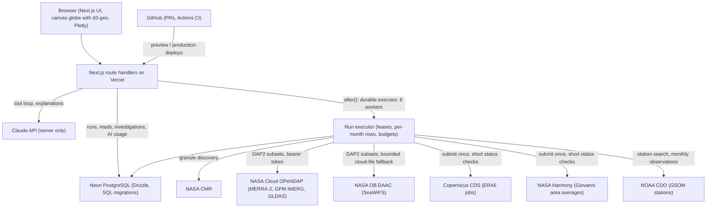

# Cryonova

AI-assisted Earth system trend research (NASA Space Apps 2026 · Earth System Trend Detective).

Cryonova turns questions into reproducible analyses of **live Earth-observation data** (NASA MERRA-2, GPM IMERG,
GLDAS, SeaWiFS and Giovanni; Copernicus ERA5; NOAA weather stations). In a three-column workspace,
teachers and students ask a question in plain English (the assistant fills the setup as an editable
proposal), or pick variables, a period and a country or custom area on an interactive globe. The plan on the
right lists the analyses and checks data sufficiency; "Start analysis" queries the provider at that moment and
opens a results dashboard with trends and uncertainty, climate diagnostics, an interpretation whose cited figures
are verified, and provenance. Investigations are saved under a random code that anyone can reopen read-only
without an account, and CSV and PDF exports come from the same stored result.

- Workspace: `/` · results: `/investigations/{runId}` · reopen by code: `/open` · sources: `/sources`
- Visual reference and original catalog: `docs/design/prototype/cryonova-earth-trend-detective.html`

- Production: https://cryonova-maria-alejandra-boada-rodriguezs-projects.vercel.app (see `docs/runbooks/access-matrix.md` for the access-protection status)
- Evidence of live reads: `docs/benchmarks/live-reads.md`
- Decisions and constraints: `docs/decision-log.md`
- Operations: `docs/runbooks/operations.md`

## What it does

| Capability | Where |
|---|---|
| Workspace: setup rail (original 22-topic catalog plus verified extensions, searchable, removable tags, derived series), period with archive coverage and suggested period, country/territory or custom area; assistant; globe; guide that becomes the investigation plan | `components/workspace/`, `src/plan/`, `src/catalog/` |
| Interactive globe: Blue Marble texture served by the app, d3-geo + world-atlas bundled (no CDN), drag/zoom/click country/draw rectangle, keyboard and list alternatives | `components/workspace/Globe.tsx` |
| Research agent: question (+ current setup and earlier turns) → editable proposal (variables, region, period) using catalog, gazetteer and live coverage tools; rule-based fallback | `src/agent/planner.ts`, `src/agent/fallback.ts`, `app/api/agent/plan` |
| Live queries: CMR discovery + Cloud OPeNDAP DAP2 subsets (MERRA-2, IMERG, GLDAS), OB.DAAC subsets with a bounded cloud-file fallback (SeaWiFS), asynchronous Copernicus CDS jobs (ERA5) and NASA Harmony/Giovanni jobs stored in Neon and advanced by polling, NOAA CDO station search and monthly observations (point data); cosine-latitude weighted regional means; durable resumable jobs with cancellation | `src/providers/`, `src/jobs/runner.ts`, `app/api/runs` |
| Statistics: OLS trend on complete-year means with Newey–West HAC (1 lag), seasonal cycle, anomalies, ranking, period comparison (Welch), seasonal trends, streaks, Benjamini–Hochberg discovery; derived series (differences, wind-vector magnitudes) | `src/analytics/`, `src/catalog/derived.ts` (parity with statsmodels in `analytics/`) |
| Interpretation in English with numeric citation check | `src/agent/explain.ts`, `src/agent/verify.ts` |
| Results dashboard (live progress, headline finding, analyses, comparison table, interpretation, provenance, save, CSV/PDF, refresh, back to setup); reopen by code on the same dashboard, read-only | `components/dashboard/`, `src/db/investigations.ts` |
| CSV (results, monthly series) and vector PDF report | `src/reports/` , `app/api/exports` |
| Connector status: live probes that read one real value where possible, plus the last real value each connector returned (`connector_checks`) | `src/providers/status.ts`, `/sources`, `/api/connectors/status` |

## Use of AI

- **Code:** written with AI coding assistance (Claude, by Anthropic).
- **Image:** the pixel-art detective guide is AI-generated; the app shows the caption "AI-generated image" directly
  under it wherever it appears.
- **Numbers:** every number Cryonova shows (values, trends, intervals, p-values) is computed by its analysis code from
  the source data: NASA Earth science data, plus Copernicus ERA5 and NOAA station records when those sources are
  selected. No number comes from AI. The assistant only proposes an editable setup and explains computed results in
  words, and the figures it cites are checked against the computed result.

## Architecture



Jobs never depend on one long HTTP response: a run is a row in `runs` plus one row per provider read in
`run_samples`. Whichever invocation holds the lease executes pending reads with per-request deadlines and
bounded retries, saves them idempotently, checks for cancellation, and hands the run back when its time budget
ends; any status poll resumes a stalled run (`src/jobs/runner.ts`, decision log D-02).

Providers that work as queued jobs (Copernicus CDS for ERA5, NASA Harmony for Giovanni) are submitted once per
run and stored in `provider_jobs`. Each later invocation makes at most one short status check per job when it is
due (10 s, rising to 60 s), downloads the result from its signed link once the provider reports it ready, and
only then writes the monthly rows. While a run waits, `progress.waitUntil` keeps client polls from resuming it
early, so no request stays open on Vercel (decision log D-29).

## Local development

Requirements: Node 22, npm, Python 3.13 (only for the statsmodels parity checks).

```bash
npm ci
cp .env.example .env.local   # fill in values; never commit them
npm run db:migrate           # applies db/migrations to DATABASE_URL_UNPOOLED (or DATABASE_URL)
npm run dev                  # http://localhost:3000
```

Without `DATABASE_URL` the app uses an in-memory store (single process). Without `ANTHROPIC_API_KEY` the
agent uses rule-based planning and explanations, clearly labeled. Without `EARTHDATA_TOKEN` runs fail with a
configuration error.

### Environment variables

| Name | Required | Purpose |
|---|---|---|
| `DATABASE_URL` | yes (deployments) | Neon pooled connection string (runtime) |
| `DATABASE_URL_UNPOOLED` | migrations | Neon direct connection string |
| `EARTHDATA_TOKEN` | yes | NASA Earthdata Login bearer token (MERRA-2, GPM IMERG) |
| `ANTHROPIC_API_KEY` | recommended | Claude API key (server only) |
| `ANTHROPIC_MODEL` | no | default `claude-sonnet-5-5` |
| `CDSAPI_URL`, `CDSAPI_KEY` | no | Copernicus CDS (ERA5 connector status) |
| `NOAA_CDO_TOKEN` | no | NOAA CDO web services (connector status) |
| `CODE_PEPPER` | no | HMAC pepper for retrieval-code hashes (changing it invalidates codes) |
| `AI_DAILY_REQUEST_LIMIT`, `AI_DAILY_BUDGET_USD`, `AI_EFFORT` | no | AI quotas (300/day, $5/day) and effort (`medium`) |
| `RUNS_PER_HOUR_PER_CLIENT`, `CODE_LOOKUP_FAILURES_PER_10_MIN`, `PROVIDER_CONCURRENCY` | no | 30, 15, 6 |

Secrets live only in Vercel (type "Sensitive") and local `.env.local`. They are never sent to the browser,
logged, or committed (`scripts/check-secrets.sh` runs in CI).

## Scripts

| Command | What it does |
|---|---|
| `npm run lint`, `npm run typecheck` | ESLint 9, TypeScript 5.9 |
| `npm test`, `npm run test:coverage` | Vitest unit tests; coverage gate 80% lines / 75% branches on critical modules |
| `npm run test:e2e` | Playwright (desktop + mobile, axe, same-origin check); `LIVE_E2E=1` adds the live journey (Start analysis → dashboard → save → reopen by code → CSV/PDF) |
| `npm run catalog:verify -- --era5-file <CDS result> --report docs/benchmarks/catalog-verification.md` | Checks every catalog variable against live metadata: OPeNDAP DDS/DAS, OB.DAAC file attributes, a CDS result's NetCDF, Harmony capabilities, the NOAA datatype listing (add `--inventory` to list all fields) |
| `npx tsx scripts/probe-credentials.ts` | One 60 s probe per credential; prints verdicts only, never values |
| `npx tsx scripts/smoke-connectors.ts start <source>` / `resume <runId>` | One short executor invocation per command against a dev database (no command waits for a provider job) |
| `npx tsx scripts/neon-branch.ts ensure|delete <name>`, `scripts/vercel-preview-env.ts` | Per-PR Neon branches and branch-scoped Vercel preview variables (used by `.github/workflows/neon-preview.yml`) |
| `python -m pytest analytics/tests` | statsmodels/scipy reference and fixture reproducibility |
| `npm run db:generate` / `npm run db:migrate` | Drizzle migration generation / application (`-- --database NAME --create-database` for a test DB) |
| `npm run smoke:live -- --start 2005-01 --end 2024-12` | One real investigation through the executor (add `--neon` to persist) |
| `npx tsx scripts/connector-status.ts` | Live connector probes |
| `npx tsx scripts/db-ping.ts`, `scripts/db-inspect.ts` | Database health and inventory (no secrets printed) |

## Deployment

GitHub `master` deploys to Vercel production; every pushed branch gets a protected preview. Flow: branch →
PR → CI green (`.github/workflows/ci.yml`) → preview `/api/health?deep=ai` healthy → merge → production
`/api/health` and a live run → record evidence. Migrations are additive and applied before merging
(`npm run db:migrate`). Rollback is in `docs/runbooks/operations.md`.

Each pull request gets its own Neon branch (`.github/workflows/neon-preview.yml`): `preview/pr-<n>` is forked
from production, migrated to the PR's schema, tested with `npm run test:integration`, and wired to the PR's
Vercel previews through branch-scoped `DATABASE_URL` / `DATABASE_URL_UNPOOLED` (the first preview is redeployed
once to pick them up). Closing the PR deletes the branch and the variables. Secrets used: `NEON_API_KEY`,
`NEON_PROJECT_ID`, `VERCEL_TOKEN`, `VERCEL_ORG_ID`.

## Data and credits

MERRA-2 (GMAO/GES DISC, doi:10.5067/AP1B0BA5PD2K and sibling collections), GPM IMERG V07
(doi:10.5067/GPM/IMERG/3B-MONTH/07) and GLDAS Noah 2.1 (doi:10.5067/SXAVCZFAQLNO), accessed live through NASA
Earthdata CMR and Cloud OPeNDAP; SeaWiFS L3m chlorophyll 2022.0 (NASA OB.DAAC,
doi:10.5067/ORBVIEW-2/SeaWiFS/L3M/CHL/2022.0); area averages by NASA Giovanni through NASA Harmony; ERA5 monthly
averaged data on single levels (Copernicus C3S/ECMWF, doi:10.24381/cds.f17050d7, CC-BY; contains modified
Copernicus Climate Change Service information); NOAA NCEI Global Summary of the Month (doi:10.7289/V5QV3JJ5)
through the CDO web services. HDF5/NetCDF-4 files are read with h5wasm (NIST, public domain; HDF5 licence). Country
boxes and borders from Natural Earth (public domain) via `world-atlas`. Globe texture: NASA Visible Earth Blue
Marble (public domain), from the `three-globe` package (MIT). The detective artwork (AI-generated) and the orbit
pattern come from the approved prototype; the app shows no NASA or Space Apps logo.
