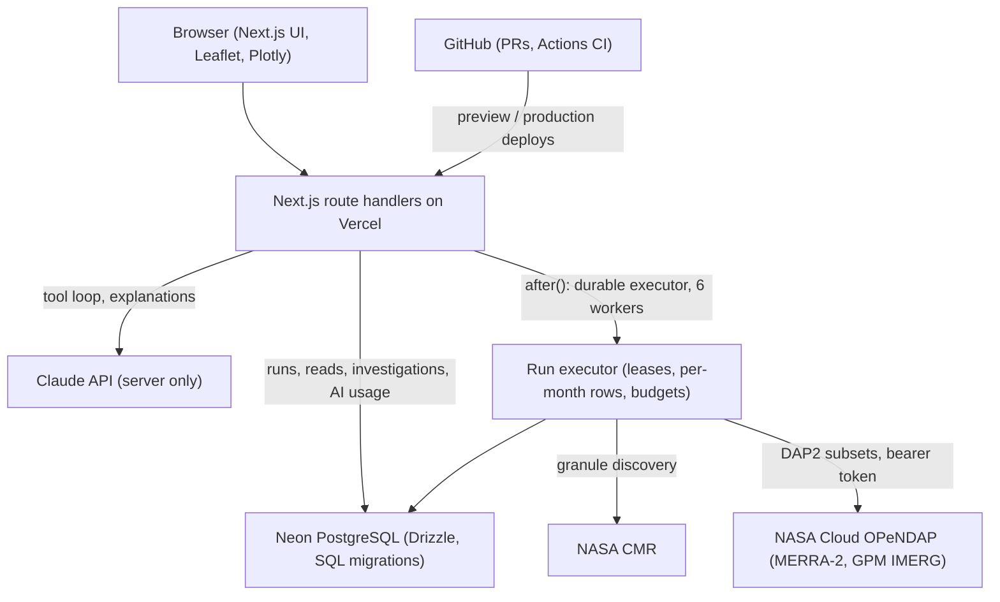

# Cryonova

AI-assisted Earth system trend research (NASA Space Apps 2026 · Earth System Trend Detective).

Cryonova turns questions into reproducible analyses of **live NASA data**. Teachers and students pick a
region, a period and one or many variables (or ask a question in English or Spanish), and Cryonova queries
the provider at that moment, computes regional series, trends with uncertainty and climate diagnostics, explains
the charts with every cited figure verified, and saves the investigation under a random code that anyone can
reopen without an account. CSV and PDF exports come from the same stored result.

- Production: https://cryonova-maria-alejandra-boada-rodriguezs-projects.vercel.app (see `docs/runbooks/access-matrix.md` for the access-protection status)
- Evidence of live reads: `docs/benchmarks/live-reads.md`
- Decisions and constraints: `docs/decision-log.md`
- Operations: `docs/runbooks/operations.md`

## What it does

| Capability | Where |
|---|---|
| Map (draw/edit/delete a rectangle, antimeridian-aware), region by name (EN/ES gazetteer), coordinates, month/year period, catalog with single- or multi-variable selection and removable tags | `components/RegionPicker.tsx`, `components/MapSelector.tsx`, `components/VariablePicker.tsx`, `src/catalog/` |
| Research agent: question → editable proposal (variables, region, period) using catalog, gazetteer and live coverage tools; rule-based fallback | `src/agent/planner.ts`, `src/agent/fallback.ts`, `app/api/agent/plan` |
| Live queries: CMR discovery + Cloud OPeNDAP DAP2 subsets, cosine-latitude weighted regional means, durable resumable jobs with cancellation | `src/providers/`, `src/jobs/runner.ts`, `app/api/runs` |
| Statistics: OLS trend on complete-year means with Newey–West HAC (1 lag), seasonal cycle, anomalies, ranking, period comparison (Welch), seasonal trends, streaks, Benjamini–Hochberg discovery | `src/analytics/` (parity with statsmodels in `analytics/`) |
| Interpretation in the user's language with numeric citation check | `src/agent/explain.ts`, `src/agent/verify.ts` |
| Save to Neon and reopen by code (hashed, throttled), refresh with live data | `src/db/investigations.ts`, `components/OpenWithCode.tsx` |
| CSV (results, monthly series) and vector PDF report | `src/reports/` , `app/api/exports` |
| Connector status (live probes) | `src/providers/status.ts`, `/sources`, `/api/connectors/status` |

## Architecture



Jobs never depend on one long HTTP response: a run is a row in `runs` plus one row per provider read in
`run_samples`. Whichever invocation holds the lease executes pending reads with per-request deadlines and
bounded retries, saves them idempotently, checks for cancellation, and hands the run back when its time budget
ends; any status poll resumes a stalled run (`src/jobs/runner.ts`, decision log D-02).

## Local development

Requirements: Node 22, npm, Python 3.13 (only for the statsmodels parity checks).

```bash
npm ci
cp .env.example .env.local   # fill in values; never commit them
npm run db:migrate           # applies db/migrations to DATABASE_URL_UNPOOLED (or DATABASE_URL)
npm run dev                  # http://localhost:3000
```

Without `DATABASE_URL` the app uses an in-memory store (single process). Without `ANTHROPIC_API_KEY` the
agent uses rule-based planning and explanations, clearly labeled. Without `EARTHDATA_TOKEN` runs fail with a
configuration error.

### Environment variables

| Name | Required | Purpose |
|---|---|---|
| `DATABASE_URL` | yes (deployments) | Neon pooled connection string (runtime) |
| `DATABASE_URL_UNPOOLED` | migrations | Neon direct connection string |
| `EARTHDATA_TOKEN` | yes | NASA Earthdata Login bearer token (MERRA-2, GPM IMERG) |
| `ANTHROPIC_API_KEY` | recommended | Claude API key (server only) |
| `ANTHROPIC_MODEL` | no | default `claude-sonnet-5-5` |
| `CDSAPI_URL`, `CDSAPI_KEY` | no | Copernicus CDS (ERA5 connector status) |
| `NOAA_CDO_TOKEN` | no | NOAA CDO web services (connector status) |
| `CODE_PEPPER` | no | HMAC pepper for retrieval-code hashes (changing it invalidates codes) |
| `AI_DAILY_REQUEST_LIMIT`, `AI_DAILY_BUDGET_USD`, `AI_EFFORT` | no | AI quotas (300/day, $5/day) and effort (`medium`) |
| `RUNS_PER_HOUR_PER_CLIENT`, `CODE_LOOKUP_FAILURES_PER_10_MIN`, `PROVIDER_CONCURRENCY` | no | 30, 15, 6 |

Secrets live only in Vercel (type "Sensitive") and local `.env.local`. They are never sent to the browser,
logged, or committed (`scripts/check-secrets.sh` runs in CI).

## Scripts

| Command | What it does |
|---|---|
| `npm run lint`, `npm run typecheck` | ESLint 9, TypeScript 5.9 |
| `npm test`, `npm run test:coverage` | Vitest unit tests; coverage gate 80% lines / 75% branches on critical modules |
| `npm run test:e2e` | Playwright (desktop + mobile, axe); `LIVE_E2E=1` adds live provider journeys |
| `python -m pytest analytics/tests` | statsmodels/scipy reference and fixture reproducibility |
| `npm run db:generate` / `npm run db:migrate` | Drizzle migration generation / application (`-- --database NAME --create-database` for a test DB) |
| `npm run smoke:live -- --start 2005-01 --end 2024-12` | One real investigation through the executor (add `--neon` to persist) |
| `npx tsx scripts/connector-status.ts` | Live connector probes |
| `npx tsx scripts/db-ping.ts`, `scripts/db-inspect.ts` | Database health and inventory (no secrets printed) |

## Deployment

GitHub `master` deploys to Vercel production; every pushed branch gets a protected preview. Flow: branch →
PR → CI green (`.github/workflows/ci.yml`) → preview `/api/health?deep=ai` healthy → merge → production
`/api/health` and a live run → record evidence. Migrations are additive and applied before merging
(`npm run db:migrate`). Rollback is in `docs/runbooks/operations.md`.

## Data and credits

MERRA-2 (GMAO/GES DISC, doi:10.5067/AP1B0BA5PD2K and sibling collections) and GPM IMERG V07
(doi:10.5067/GPM/IMERG/3B-MONTH/07), accessed live through NASA Earthdata CMR and Cloud OPeNDAP. Country
boxes from Natural Earth (public domain) via `world-atlas`. Map tiles © OpenStreetMap contributors.
